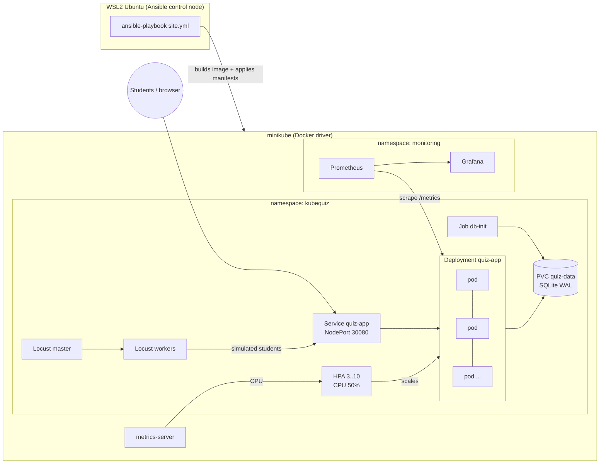

# KubeQuiz: Kubernetes-Based Online Quiz System

A scalable online examination platform, built as **DevOps Project 7**:

| Requirement | How KubeQuiz does it |
|---|---|
| **Docker**: quiz application containers | Flask app in a multi-stage, non-root image (`app/Dockerfile`), plus `docker-compose.yml` for local development |
| **Kubernetes**: multiple application replicas | Deployment with **3 to 10 replicas** behind a Service; shared SQLite volume; health probes; rolling updates |
| **Ansible**: automated deployment | `ansible/site.yml` installs the tools, starts minikube, builds the image, and deploys the app, monitoring and the load generator; idempotent |
| **Extension**: horizontal scaling with simulated users | HorizontalPodAutoscaler (50% CPU) + **Locust** simulated students; `ansible/scale-demo.yml` shows the scale-out and scale-in; Grafana dashboard |

Project documents: [PRD](docs/PRD.md) · [progress log](CONTEXT.md) · [design decisions](DECISIONS.md)

---

## Architecture



**Request flow:** the Service load-balances every request to any ready pod. Pods are **stateless**: the student's name and quiz start time live in a signed session cookie, and all pods share one `SECRET_KEY`. Any replica can therefore serve any step of a quiz, and each page footer shows which pod served it.

**Data:** every replica mounts the same PersistentVolume holding `quiz.db`. SQLite runs in WAL mode with a busy timeout. This works because minikube is a single node; a multi-node cluster would need Postgres (see [D-002](DECISIONS.md)).

## Features

- **Students:** enter a name, take a timed multiple-choice quiz (auto-submit at 0; the time limit is also enforced on the server), see the score with a per-question review, and see the leaderboard.
- **Admin** (`/admin`, password from a Kubernetes Secret): create, edit and delete quizzes; add and delete questions; see totals. Forms are CSRF-protected.
- **Ops endpoints:** `/healthz` (liveness), `/readyz` (readiness, checks the DB), `/metrics` (Prometheus), `/api/info` (shows which pod answered), `/api/stats`, `/api/quizzes`.

## Repository layout

```
app/                Flask application, tests, Dockerfile, gunicorn config
loadtest/           locustfile.py (simulated students), used by compose, K8s and CI
k8s/                Plain Kubernetes manifests (kubectl-apply-able)
  locust/           Locust master/workers + headless load-test Job
  monitoring/       ServiceMonitor for Prometheus
monitoring/         kube-prometheus-stack values + Grafana dashboard JSON
ansible/            site.yml, teardown.yml, scale-demo.yml, roles/
scripts/            WSL bootstrap, playbook runner, port-forward, watch, e2e smoke test
.github/workflows/  CI: lint, tests, manifest/Ansible validation, kind E2E, GHCR publish
```

---

## 1. Quick start with Docker only

```bash
docker compose up --build                 # app on http://localhost:8080
docker compose --profile load up          # + Locust UI on http://localhost:8089
```
Admin password: `admin`.

## 2. Full Kubernetes deployment (Windows + WSL2)

**You need:** Docker Desktop with *Settings → Resources → WSL Integration → Ubuntu* turned on, and about 6 GB of RAM free.

```bash
# in an Ubuntu (WSL) terminal
cd /mnt/d/projects/KubeQuiz

# one-time: installs uv, ansible-core and the kubernetes.core collection into ~/.local (no sudo)
bash scripts/wsl-bootstrap.sh

# everything else: minikube, kubectl, helm, cluster, image, app, monitoring, Locust
bash scripts/run-playbook.sh site.yml
```
Run `site.yml` a second time: every task reports `ok`, nothing `changed`. That is idempotency.

Useful variants:
```bash
bash scripts/run-playbook.sh site.yml --tags deploy               # rebuild + redeploy only the app
bash scripts/run-playbook.sh site.yml -e enable_monitoring=false  # lighter, no Prometheus/Grafana
```

Open the UIs (WSL forwards these ports to Windows):
```bash
bash scripts/port-forward.sh
```
| What | URL | Login |
|---|---|---|
| Quiz app | http://localhost:8080 | admin password `admin123` |
| Locust | http://localhost:8089 | |
| Grafana | http://localhost:3000 | `admin` / `admin` |
| Prometheus | http://localhost:9090 | |

> `scripts/run-playbook.sh` exists because the repo lives on `/mnt/d`, which WSL mounts as world-writable, and Ansible ignores an `ansible.cfg` in such a directory. The wrapper sets `ANSIBLE_CONFIG` explicitly.

### What `site.yml` does

| Role | Steps |
|---|---|
| `prereqs` | Checks Docker; downloads pinned **minikube v1.39.0, kubectl v1.37.0, helm v3.22.1** (checksum-verified) into `~/.local/bin` |
| `cluster` | `minikube start` (4 CPUs, 4600 MB, Kubernetes v1.37.0) if not running; enables **metrics-server**; waits for the node |
| `build` | Builds `kubequiz:1.0.0` **inside minikube's Docker** (no registry); reports `changed` only if the image ID changed |
| `deploy` | Namespace → Secret (from `group_vars`) → ConfigMap + PVC → **db-init Job** (once) → Deployment + Service + HPA → stamps the image ID on the pod template (rolls pods only when the image changed) → waits for 3 ready replicas |
| `monitoring` | Helm installs **kube-prometheus-stack 93.1.0** (slim values), the Grafana dashboard ConfigMap and the ServiceMonitor |
| `loadtest` | locustfile ConfigMap (from `loadtest/locustfile.py`), Locust master + 2 workers |

Settings live in [`ansible/group_vars/all.yml`](ansible/group_vars/all.yml). For real deployments, encrypt the secrets with `ansible-vault encrypt_string`.

## 3. The scaling demo (the "extension")

Terminal 1:
```bash
bash scripts/watch-scaling.sh        # live: HPA, pod CPU, pods
```
Terminal 2:
```bash
bash scripts/run-playbook.sh scale-demo.yml
# or with your own numbers:
bash scripts/run-playbook.sh scale-demo.yml -e demo_users=500 -e demo_duration=8m
```
What happens:
1. The playbook writes the load profile (default **300 simulated students, +10/s, 5 minutes**) and starts the headless Locust Job.
2. Each simulated student logs in, opens random quizzes, answers, submits, and checks the leaderboard.
3. Pod CPU rises above 50% of the 100m request, and the **HPA adds pods** (up to +4 per 15 s, max 10). The playbook waits until at least 5 replicas are running.
4. The playbook prints the Locust summary (requests, failures, latency).
5. When the load stops, the HPA **scales back to 3** after a 60 s stabilization window.

You can also drive it by hand from the Locust UI (http://localhost:8089) and watch the Grafana dashboard **"KubeQuiz: scaling overview"**: replicas (current, desired, max), CPU per pod against the target, requests per second per pod, p50/p95 latency, 5xx errors and quiz submissions per minute.

Other things worth showing:
```bash
# load balancing: different pods answer
for i in $(seq 10); do curl -s localhost:8080/api/info; echo; done

# self-healing: delete a pod, the Deployment replaces it, no downtime
kubectl -n kubequiz delete --wait=false \
  "$(kubectl -n kubequiz get pod -l app.kubernetes.io/component=web -o name | head -1)"
kubectl -n kubequiz get pods -w
```

## 4. Tear down

```bash
bash scripts/run-playbook.sh teardown.yml                          # remove app + monitoring
bash scripts/run-playbook.sh teardown.yml -e destroy_cluster=true  # delete minikube entirely
```

---

## Testing and CI

```bash
cd app
python -m venv .venv && .venv/Scripts/pip install -r requirements-dev.txt   # Windows path; use .venv/bin on Linux
.venv/Scripts/python -m pytest            # 22 tests
.venv/Scripts/python -m flake8 kubequiz tests
```

The tests cover scoring, the full quiz flow, late submission, **statelessness** (a second app instance, standing in for another pod, accepts the first one's session), admin CRUD + CSRF, health, the API and metrics.

[GitHub Actions](.github/workflows/ci.yml) runs these jobs on every push and PR:

| Job | What it checks |
|---|---|
| `test` | flake8 + pytest |
| `infra-lint` | kubeconform (strict) on `k8s/`, `ansible-playbook --syntax-check`, ansible-lint, shellcheck, dashboard JSON |
| `e2e` | Builds the image, creates a **kind** cluster, runs [`scripts/e2e-smoke.sh`](scripts/e2e-smoke.sh): seed Job, 3 ready replicas, in-cluster requests spread over ≥2 pods, a 30 s Locust run with **0 failures**, attempts stored in the shared DB |
| `publish` | On `main` only: pushes `ghcr.io/<owner>/kubequiz:{1.0.0, sha-…, latest}` |

## Kubernetes design notes

- **The HPA owns the replica count.** The Deployment has no `replicas:` field; otherwise every `apply` would reset it and fight the autoscaler.
- **Probes:** a `startupProbe` and `livenessProbe` on `/healthz`, plus a `readinessProbe` on `/readyz`. A pod whose DB is unreachable is taken out of the Service without being restarted.
- **Zero-downtime updates:** `maxUnavailable: 0`, `maxSurge: 1`, a `preStop` sleep and gunicorn's graceful timeout.
- **Hardening:** runs as non-root UID 10001, read-only root filesystem, all capabilities dropped, no privilege escalation; secrets come only from a Secret.
- **Resource requests** (cpu 100m / mem 128Mi) are what the HPA's CPU percentage is calculated against.

## Troubleshooting

| Symptom | Fix |
|---|---|
| `docker info` fails in WSL | Start Docker Desktop; enable WSL integration for Ubuntu |
| HPA `TARGETS` shows `<unknown>` | metrics-server is still starting; wait about 1 minute (`kubectl -n kube-system get deploy metrics-server`) |
| `minikube start` fails on memory | Lower `minikube_memory_mb` in `group_vars/all.yml` or raise Docker Desktop's memory limit |
| Grafana/Prometheus too heavy | `-e enable_monitoring=false` |
| Ansible ignores `ansible.cfg` | Use `scripts/run-playbook.sh` (see above) |

## Known limitations

- SQLite on a shared single-node volume: correct on minikube, not for multi-node clusters (use Postgres there).
- Student identity is just a display name, and the demo secrets in `group_vars` are plaintext (use Ansible Vault in real use).

## Screenshots

_Add for the report: app home page with the pod name in the footer · `kubectl get hpa -w` during the demo · Grafana dashboard during scale-out · Locust UI · Ansible `site.yml` recap._
